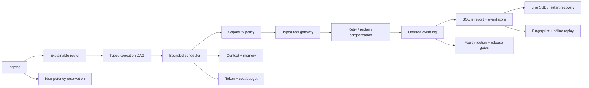

# Agentic Control Plane

HarnessLab v0.4 provides an offline-reproducible control plane for production Agent workflows. It is
deliberately model-agnostic: a model may propose a plan, but the runtime owns validation,
authorization, budgets, execution, recovery, and evidence.

## Architecture



| Boundary | Owns | Does not own |
| --- | --- | --- |
| Router | Explainable simple/complex preflight | Tool execution |
| Planner contract | Acyclic steps and dependencies | Permissions |
| Scheduler | Ready sets, bounded parallelism, timeout, cancellation | Natural-language policy |
| Policy | Run-scoped capabilities, taint, egress gates | Business side effects |
| Tool gateway | JSON Schema, idempotency metadata, compensators | Model choice |
| Memory | Context windows, TTL, deduplication, retrieval | Authorization |
| Budget | Input/output/tool/cost/wall-time limits | Quality scoring |
| Event log | Ordered redacted evidence | Raw model context |
| Run store | Idempotency, reports, events, restart recovery | Distributed consensus |

## Durable Run Lifecycle

`POST /api/agent/runs` reserves a Run and returns `202 Accepted`; execution continues in a named
background task. An optional `Idempotency-Key` is committed atomically with the request hash. The
same key and payload returns the original Run, while the same key with a different payload returns
`409 Conflict`. A caller-provided duplicate `run_id` is also rejected.

Reports and redacted events use separate SQLite tables. Events are keyed by `(run_id, sequence)`,
so duplicate or out-of-order persistence fails instead of silently rewriting audit history. On
startup, any retained `queued` or `running` report is converted to an explicit failed terminal
record with `reason=worker_interrupted`. This is single-process durability, not a claim of
distributed exactly-once execution.

Completed Runs export `harnesslab.agent-run/v1`. The execution fingerprint removes Run IDs,
timestamps, durations, and elapsed wall time for deterministic comparison. A separate integrity
fingerprint covers the full redacted artifact. `harnesslab agent-replay` recomputes both and checks
event sequence, terminal state, plan identity, attempt order, policy order, budget enforcement,
and terminal step states without network access.

## Recovery Semantics

| Failure | Retry | Replan | Rollback | Default |
| --- | --- | --- | --- | --- |
| Transient + idempotent | Bounded | Optional | No | Retry |
| Transient + non-idempotent | No | Optional | If prior effects exist | Abort |
| Permanent dependency loss | No | Safe fallback | Optional | Replan/abort |
| Invalid arguments/output | No | Planner fix only | Optional | Abort |
| Policy denial | No | Only to a lower-risk path | No new effects | Abort |
| Budget exceeded | No | Cheaper path if pre-authorized | Optional | Abort |
| Downstream canary failure | No | Optional | Reverse completion order | Rollback |

Compensation is not a database transaction claim. Each effectful tool must declare an explicit
compensator, and compensation outcomes are retained as first-class events.

## Security Model

- HMAC capability tokens bind subject, run ID, capabilities, issued time, expiry, and token ID.
- Side-effecting tools implicitly require `tool.write` in addition to domain capabilities.
- Tokens fail on tampering, expiry, future issuance, or cross-run replay.
- External results are scanned for instruction override, role spoofing, secret exfiltration, and
  privileged-tool escalation patterns.
- Tainted output may be inspected by read-only tools but cannot drive a side effect.
- Tools with URL arguments can declare an egress hostname allowlist.
- Event payloads use the existing recursive HarnessLab redaction boundary.

## Memory and Context

`ContextCompiler` implements both message and token windows. Token mode reserves output capacity,
keeps the system message, and selects recent messages without exceeding the preflight budget.

`HybridMemoryStore` is an offline reference implementation with normalized SHA-256 deduplication,
TTL expiration, bounded per-namespace growth, optimistic version checks, and deterministic lexical,
recency, and importance scoring. A production adapter can replace lexical scoring with vector +
BM25 retrieval while preserving the contract and regression tests.

## Model Selection

`ModelSelector` applies hard gates before weighted scoring. A candidate must satisfy context,
quality, safety, p95 latency, tool-success, and request-cost constraints. Only eligible candidates
are ranked. Reference profiles are synthetic fixtures, not vendor benchmark claims.

This makes the base-versus-fine-tuned decision testable: a domain SFT may have higher answer
quality but remain ineligible for a tool-heavy workload if structured tool success misses the gate.

## Executable Scenarios

```bash
harnesslab agent-run --scenario enterprise-recovery
harnesslab agent-run --scenario replan-fallback
harnesslab agent-run --scenario rollback-on-deploy-failure
harnesslab agent-run --scenario prompt-injection
harnesslab agent-run --scenario enterprise-recovery --artifact run.agent.json
harnesslab agent-replay run.agent.json
harnesslab agent-eval
```

The nine reference gates cover idempotent retry, fallback replanning, saga compensation, injection
containment, tool budgets, bounded DAG parallelism, context/memory bounds, model selection, and
per-user traffic control.

## API

| Method | Path | Purpose |
| --- | --- | --- |
| `GET` | `/api/agent/scenarios` | List deterministic failure scenarios |
| `POST` | `/api/agent/runs` | Submit a durable background run (`202 Accepted`) |
| `GET` | `/api/agent/runs` | List retained Agentic reports |
| `GET` | `/api/agent/runs/{id}` | Inspect DAG steps, attempts, recovery, policy, and budget |
| `GET` | `/api/agent/runs/{id}/events` | Stream ordered events with SSE resume support |
| `POST` | `/api/agent/runs/{id}/cancel` | Request cooperative in-flight cancellation |
| `GET` | `/api/agent/runs/{id}/artifact` | Export the portable replay contract |
| `POST` | `/api/agent/evals` | Re-run the release-gate matrix |
| `GET` | `/api/agent/evals` | Read the latest matrix |

The local workbench auto-issues capabilities only for deterministic fixture tools. A real tool
integration must provide server-issued caller capabilities and disable demo issuance at its API
boundary. Set a strong, stable `HARNESSLAB_AGENT_SIGNING_SECRET` when capability tokens must remain
verifiable across process restarts; the random development default is intentionally process-local.
